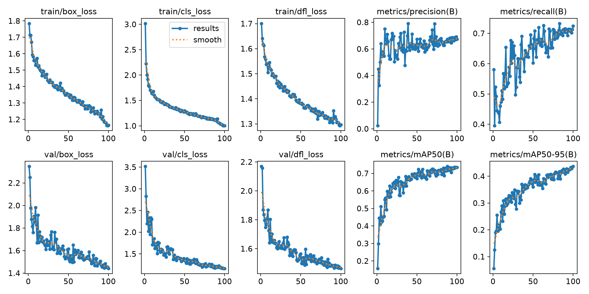

# 面向低对比度与纹理干扰的钢材表面缺陷鲁棒检测

基于 YOLO11n 的六类钢材表面缺陷检测实验，覆盖数据核验、训练消融、阈值校准、本地图像推理和 GPU 部署。研究低对比度退化与复杂纹理下的定位问题，并用重复实验和外部数据压力测试限定结论。

技术栈：**Python · PyTorch · YOLO11n · OpenCV · NumPy · ONNX · TensorRT · CUDA**。

## 问题与方法

钢材纹理与缺陷形态相近，弱边缘和低对比度会增加定位难度。项目采用六类目标检测，保持推理预处理不变，在训练时加入概率 0.5、强度 Uniform(0.7, 1.3) 的均值中心对比度扰动。与相同初始化、训练配置的基线进行种子 42/43/44 配对比较；另测试关闭 mosaic 的消融。

数据按内容指纹核验，重复框去重，冲突样本隔离，近重复候选成组划分。模型与置信度只通过验证集选择；训练、验证、测试分别为 1259、269、270 张。纹理分析属于诊断工具，本项目没有证明纹理干扰被普遍消除。

## 实验结果

- 最终测试集：mAP50 **75.6021%**，mAP50–95 **44.8650%**。固定置信度 0.4、NMS IoU 0.7、匹配 IoU 0.5：TP/FP/FN = **408/112/204**，P/R/F1 = **78.4615% / 66.6667% / 72.0848%**。
- 对比度 α=0.5 的合成扰动：三种子平均 mAP50–95 从 **34.6158% 到 40.9653%**，提高 **6.3494 个百分点**，3/3 种子为正。干净验证平均仅提高 **0.03875 个百分点**，增益不稳定；高斯噪声 σ=10 下降 **1.2544 个百分点**。
- 关闭 mosaic：三种子平均提高 **0.4738 个百分点**，未达到预设 +1 个百分点门限，未替换默认模型。
- RTX 4090、batch=1、320×320：主顺序请求 P50 为 PyTorch FP32 **8.081 ms**、TensorRT FP16 **3.177 ms**；反顺序为 **7.875 / 3.419 ms**，对应 **2.54× / 2.30×**。包含解码至 CPU 结果转换，排除加载和序列化，不能直接作为产线吞吐率。FP16 同路径 AP50–95 降低 **0.0551 个百分点**，显存没有降低。
- 边界：龟裂固定阈值召回仅 **8.9109%**；GC10-DET 未适配跨类别框定位 F1 仅 **2.6609%**，表明未适配的外部数据泛化能力有限。



详细协议、不同输入路径口径与失败结果见 [实验报告](docs/experiments.md)。`results/` 保存训练、评估与部署实验的原始数值记录及聚合结果。

## 快速运行

建议 Python 3.12。从仓库根目录执行：

```bash
python -m venv .venv
source .venv/bin/activate
python -m pip install -r requirements.txt
python scripts/predict.py path/to/image.jpg --weights models/best.pt --profile models/inference_profile.json --device cpu --output runs/predictions
python -m unittest discover -s tests -v
```

可传入多个图片路径进行批量检测。输出包含标注图、JSON、CSV 和 ZIP；输入图片请自行准备。仅加载可信来源的 PyTorch checkpoint。

发布权重移除了训练环境元数据，499 个 state_dict 张量及原始前向输出保持一致。CPU 等价验证与发布版、历史实验版权重的 SHA256 分别记录于 [模型说明](models/README.md)。

## 数据准备与训练

本仓库不再分发 NEU-DET / GC10-DET 图片、标注、带标注派生图或数据压缩包。请从原作者发布获取并确认用途许可，按 [数据准备](docs/data.md) 放置本地文件。

```bash
python scripts/prepare_data.py --source data/raw/NEU-DET --output data/processed --curation configs/data_curation.json
python scripts/train.py --config configs/control.yaml --initial-weights models/yolo11n.pt --data data/processed/data.yaml --device 0 --project runs
python scripts/evaluate.py --weights models/best.pt --data data/processed/data.yaml --config configs/control.yaml --output runs/validation --split val --device cpu
```

训练前需自行下载官方初始化权重 `yolo11n.pt`。GPU 环境、ONNX/TensorRT 生成命令见 [部署说明](docs/deployment.md)。测试集评估要求显式冻结并匹配当前数据、配置与权重摘要；公开版不能直接复用历史冻结文件。

## 目录

```text
src/steel_defect/   数据、增强、评估、推理与 GPU 后端
scripts/           数据准备、训练、评估、校准和部署命令
configs/           基线、消融配置及哈希绑定的数据分组
models/            公开推理权重、推理配置和等价性记录
results/           原始数值日志、聚合指标与训练曲线
data/             仅文件名/哈希/划分清单（原始数据不入库）
docs/              实验协议、数据来源、环境与许可
tests/            合成夹具单元测试
```

## 来源与许可

项目基于 Ultralytics YOLO11，增强训练器参考其数据集/训练器接口；保留上游署名。源码与公开权重按 [AGPL-3.0](LICENSE) 分发，第三方依赖及数据各自适用原许可，详见 [NOTICE](NOTICE.md)。训练数据缺少明确的完整再分发授权，因此不随仓库发布。实验限于上述数据版本与协议，未验证真实产线正常样本、缺陷流行率或长期漂移。
